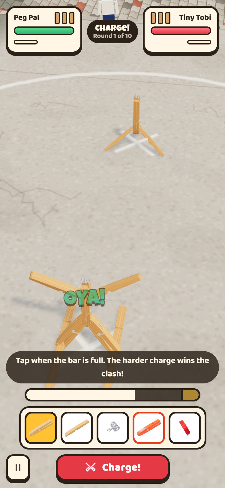
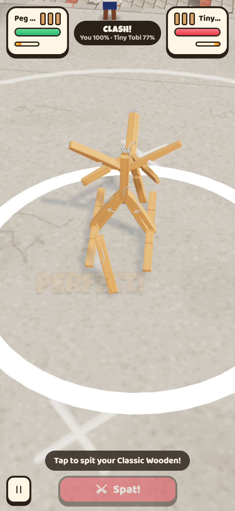
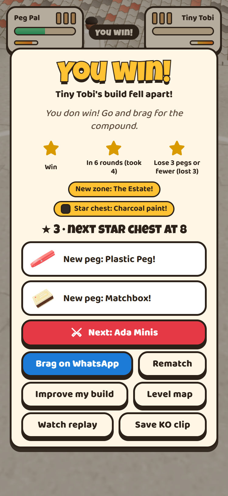
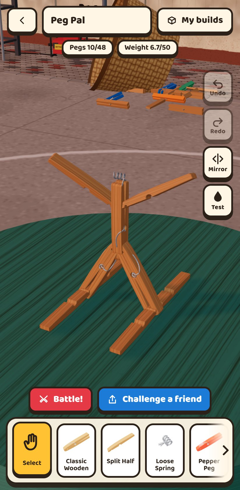
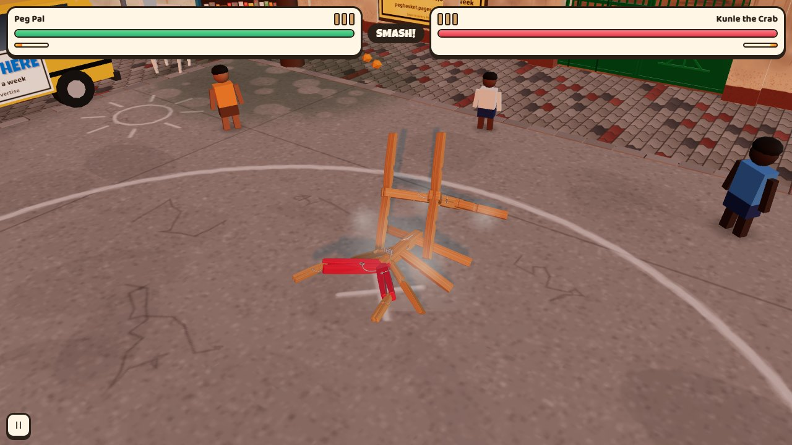
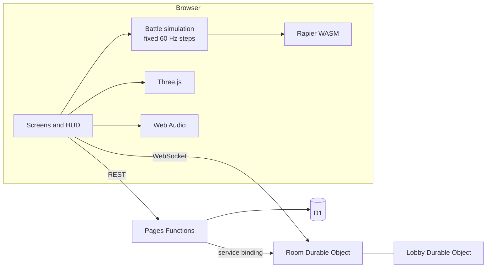
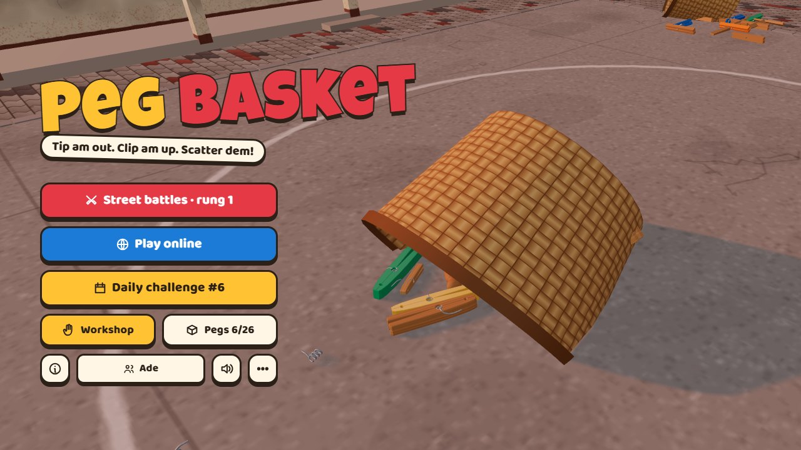

# Peg Basket

A 3D clothes-peg battle game for the browser. You clip pegs into a fighter in a
workshop, then battle it through 40 levels or against a friend live. It is the
peg game Nigerian kids played in the compound, rebuilt as a web game that loads
in seconds on a cheap phone.

**Play it:** https://pegbasket.pages.dev ·
**Live numbers:** https://pegbasket.pages.dev/stats ·
**Press kit and video:** https://pegbasket.pages.dev/press

  
  
  

> This repository is a showcase. Peg Basket is a product in development, so its
> full source is private. Here you will find how it is built, what was hard, and
> a few source files picked to show the code. See [What is in this repository](#what-is-in-this-repository).

## What I built

| Part | What it does |
|---|---|
| Workshop | Clip up to 48 pegs at any angle on a 3D board, with mirror mode, undo, a drop test and 22 paints. |
| Clash battles | Both builds charge at once. One button: tap when the bar is full to charge, tap again to spit a peg. The harder charge keeps its pegs and takes ground. |
| Level map | 40 levels in 5 zones. Each level has 3 star goals, zones open on stars, and star chests unlock paints. |
| Elements | 7 elemental pegs (fire, water, ice, shock, wind, oil, gum) with statuses, guards and a special move per element. |
| Live multiplayer | Two phones fight in a room by link or code, with spectators, rematch and a step-away timer. |
| Online Street | Publish a build and other players fight it while you are away. |
| Daily Challenge | One boss a day, three tries, enforced on the server. |
| Replays | Every knockout replays from a moving camera and can be saved as a video clip. |
| Public KPI page | Players, battles, retention and funnel numbers, live, with test traffic kept out. |

  
  

## The stack

- **Client:** vanilla JavaScript modules built with Vite, Three.js for drawing, Rapier (WebAssembly) for physics, Web Audio for sound. Every sound and the music are made in code, so there are no audio files to download.
- **Server:** Cloudflare Pages Functions for the API, a D1 (SQLite) database, and a separate Worker with Durable Objects for live rooms over WebSockets.
- **Tests:** Node's built-in test runner for the simulation and API, Playwright for the browser.
- **Cost:** it runs on free tiers.

## Engineering problems worth reading about

**1. Two phones must compute the same fight.** Live play sends only each
player's shot, and both phones run the physics. That only works if the
simulation is repeatable to the last bit. `Math.sin`, `Math.cos` and `Math.pow`
can differ in the last digit between Chrome and Safari, and physics grows that
into a different fight. So the simulation uses its own maths
([samples/detmath.js](samples/detmath.js)), a seeded random number generator
([samples/rng.js](samples/rng.js)) and fixed time steps. Both phones compare a
hash of the whole fight after every turn, and if the hashes differ the shooter
sends a snapshot. One bug found this way: JSON turns `-0` into `0`, and the
physics engine can tell them apart.

**2. A computer rival that thinks without freezing the game.** Harder rivals
try several shots in a copy of the physics world before choosing one. That
search is a generator function, so the game runs a few milliseconds of it each
frame. On a CPU slowed to a quarter speed the worst frame went from 228 ms to
about 20 ms.

**3. Rooms that cost nothing while idle.** Each live fight is a Durable Object
that uses WebSocket hibernation, so an open room with nobody talking uses no
CPU. The room rebuilds what it knows when it wakes, sweeps sockets that died
silently, and forfeits a player who stays away for a minute.

**4. Replays without recording.** A replay is the saved state from just before
the last shot plus the inputs, run again. Because the simulation is repeatable,
the replay matches what happened. Clash fights add a mid-flight action, so the
simulation logs the step it happened on and plays it back on that step
([samples/clash.test.js](samples/clash.test.js) pins this).

**5. A deploy that cannot ship a broken game.** One command runs the unit
tests, builds, runs the browser tests, applies database changes, deploys the
room Worker and the site, and then runs checks against the live site. If any
step fails, nothing after it runs.

**6. Privacy by design.** No account is needed. Analytics use a random install
id and the country Cloudflare reports, and nothing else. The game publishes a
fair-play promise: difficulty never depends on device, country, adverts seen or
money spent.

## Testing

| Layer | What it covers |
|---|---|
| 95 unit tests | Simulation rules, exact repeatability, saved states, link and save formats frozen against real data, room logic, API handlers |
| 127 browser test runs a release | The same specs in desktop Chrome, an Android-sized Chrome with real touch, and WebKit as an iPhone |
| Layout checks | Every screen at five sizes, with an automatic search for buttons that overlap, text cut short or builds hidden by controls ([samples/layout-check.js](samples/layout-check.js)) |
| Two-player tests | Two real browsers in one room: shots, hidden tabs, rematch, dropped connections |
| Speed budget | The simulation on a CPU slowed to a quarter |
| Live checks | The same kind of tests against the deployed site after every release |

The code is about 24,000 lines of JavaScript, with about 4,500 lines of tests.

## Product decisions

- **A goal for every fight.** Early players won their first fight and then did not come back, and one said the game had no clear goal. I added the level map with star goals and chests, then replaced the turn-by-turn controls in level fights with Clash, which needs one button and no aiming.
- **Balance by simulation.** A headless tool plays every level many times at different skill levels and prints win rates, fight length and how fights end. Tuning changes are checked against it before a person plays.
- **Honest numbers.** The KPI page is public and excludes automated traffic.

## What is in this repository

| Path | What it is |
|---|---|
| `README.md` | This case study |
| `docs/architecture.md` | How the parts fit together, in more detail |
| `samples/` | Four source files from the real project. They are excerpts and do not run on their own. |
| `media/` | Screenshots |

Not included: the game simulation, level and balance data, server code, deploy configuration and business documents.

## About

Built by Ademola Adegbola. More work: https://adecodes-dot.github.io

© 2026 Ademola Adegbola. All rights reserved. See [LICENSE](LICENSE).
