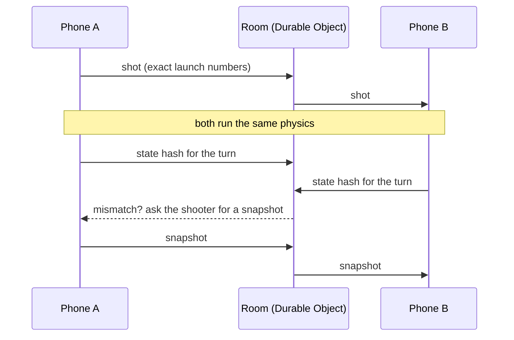
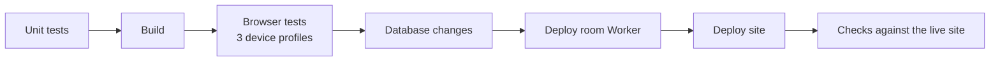

# Architecture

## The client

The game is a single page with no framework. Each screen (title, workshop,
level map, battle, online, daily) is a class with `enter`, `update` and `exit`.
One 3D stage is shared by all of them.

The battle is split in three so that each part can be tested alone:

| Part | Job | Knows about |
|---|---|---|
| Simulation | Rules and physics. Takes inputs, emits events (`detach`, `knockdown`, `turn`, `over`). | Nothing outside itself. Runs in Node for tests and balance checks. |
| View | Draws what the simulation holds. | The simulation, read-only |
| Screen and HUD | Input, camera, sound, slow motion, banners. | Both |

Because the simulation has no drawing or timing code, the same file runs in the
browser, in unit tests, in the balance tool and in replays.

### Fixed steps

The simulation advances in steps of 1/60 s whatever the frame rate. The world
holds still while a player aims, so every shot starts from the same moment on
both phones.

### Damage

A build is a tree of pegs. Each clip between two pegs has hit points. A contact
in the physics engine becomes damage to the clip of the peg it lands on, with a
share passed to the pegs hanging off it. When a clip breaks, the pegs beyond it
fall away as one loose piece. A build is out when it has lost 60% of its pegs.

## Live play

- The shooter's phone works out the launch velocity and sends the numbers, so the other phone needs no trigonometry of its own.
- The room is the referee for turn order, clocks and results. It never runs physics.
- A page that goes to the background says so and closes its socket. The other player sees a countdown, and the fight is forfeited after 60 seconds.
- A phone that reconnects mid-fight is sent the shots it missed and fast-forwards through them.

## The server

| Piece | Used for |
|---|---|
| Pages Functions | REST API: saves, published builds, daily scores, leaderboards, analytics events |
| D1 | Players, builds, daily tries and scores, event counts |
| Room Durable Object | One live fight: sockets, turn clock, spectators, rematch |
| Lobby Durable Object | Quick-match queue |

Rules that matter are enforced on the server. For example, the Daily Challenge
allows three tries a day, counted in the database, and a fourth is refused.

## Release pipeline

Each step runs only if the one before it passed.

## Balance tool

A script plays fights with no graphics. It takes a level, a number of fights and
a skill level for the simulated player, and prints win rate, rounds, pegs lost
and how the fights ended. It was used to tune Clash so that a middling player
wins most early levels in four to seven rounds and bosses need a better build.
